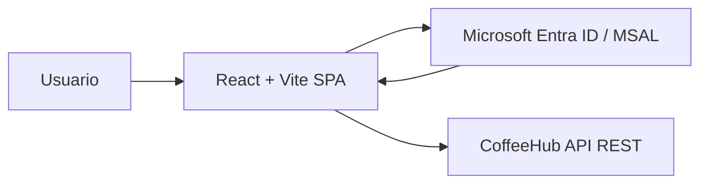

# Arquitectura e infraestructura

## Vista general

CoffeeHub Frontend se despliega como una SPA moderna construida con React + Vite. No requiere un runtime backend propio ni un motor de base de datos. Su arquitectura se centra en:

- renderización del cliente en navegador
- autenticación con Microsoft Entra ID
- consumo de la API REST de CoffeeHub
- despliegue como sitio estático



## Componentes

| Componente | Responsabilidad |
| --- | --- |
| React + Vite | Interfaz principal y render de la SPA |
| React Router | Navegación y vistas por rol |
| MSAL | Inicio de sesión, refresh y tokens |
| API Client | Llamadas HTTP autenticadas a la API |
| Hosting estático | Entrega del frontend en producción |

## Flujos principales

### Flujo público

- El usuario accede a `/`
- La interfaz carga contenido público
- No requiere autenticación

### Flujo de cliente

- El usuario inicia sesión
- MSAL obtiene token de acceso
- El frontend lo adjunta a peticiones a la API
- Se valida acceso a rutas de cliente

### Flujo administrativo

- El usuario autenticado tiene rol `ROLE_ADMIN`
- La SPA habilita rutas administrativas
- El backend valida permisos para cada operación

## Seguridad

La seguridad en frontend debe cumplir estos principios:

- no se deben exponer secrets del cliente
- usar solamente configuración pública vía `VITE_*`
- las rutas privadas deben protegerse en UI
- el token debe manejarse con cuidado y no persistirse en código fuente
- la validación de permisos debe reforzarse en backend

## Configuración local

Un entorno local típico requiere:

```bash
npm install
cp .env.example .env
npm run dev
```

Ejemplo de configuración:

```env
VITE_API_BASE_URL=http://localhost:8080/api/v1
VITE_AUTH_TENANT_ID=<tenant-id>
VITE_AUTH_CLIENT_ID=<client-id>
VITE_AUTH_AUTHORITY=https://login.microsoftonline.com/<tenant-id>
```

## Despliegue

El frontend se despliega como sitio estático, idealmente con:

- Vercel
- Netlify
- Azure Static Web Apps
- GitHub Pages o cualquier hosting compatible con Vite

Se recomienda:

- build de producción con `npm run build`
- publicación del directorio `dist`
- variables de entorno configuradas en el proveedor
- redirecciones SPA para rutas internas

## Observabilidad y operación

La observabilidad del frontend se enfoca en:

- errores de render
- fallos de acceso a API
- autenticación y expiración de sesión
- rendimiento de navegación
- uso de rutas por tipo de usuario

Se recomienda usar logs de navegador, métricas de rendimiento y monitoreo del hosting.

## Evolución

El frontend puede crecer en complejidad con:

- diseño de sistema
- componentes reutilizables
- caché de datos
- dashboard administrativo más avanzado
- internacionalización
- soporte de múltiples entornos

No forma parte del alcance del módulo la implementación del backend, la persistencia ni la lógica de negocio del dominio.