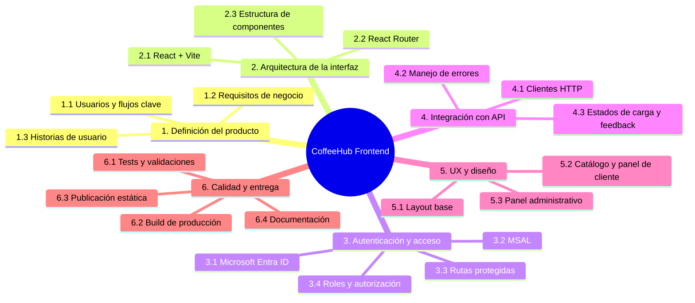
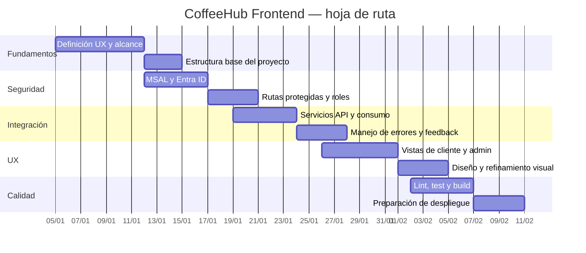

# Planificación del Frontend

## Enfoque

El trabajo del frontend se organiza en entregables incrementales centrados en la experiencia de usuario, la seguridad y la integración con la API. La prioridad es entregar una SPA funcional que soporte navegación por roles y autenticación segura antes de avanzar en refinamientos visuales y despliegue.

## WBS

## Cronograma sugerido

## Entregables por fase

| Semana | Fase | Actividades | Entregable |
| --- | --- | --- | --- |
| 1 | Alcance y estructura | Definición de arquitectura y UX | SPA base con rutas iniciales |
| 2 | Seguridad | MSAL, Entra ID y autorización | Flujo de autenticación funcional |
| 3 | Integración | Servicios API y manejo de respuestas | App conectada a la API |
| 4 | Experiencia | Diseños para cliente y administración | Interfaz completa |
| 5 | Calidad | Build, pruebas y documentación | Frontend validado |
| 6 | Despliegue | Hosting y configuración | Proyecto listo para publicación |

## Definición de terminado

Una tarea del frontend se considera terminada cuando:

- la funcionalidad se ejecuta correctamente
- la autenticación funciona en entorno real o simulado
- la navegación por roles responde como se espera
- el build de producción pasa
- la documentación refleja el estado actual
- existe validación manual de la experiencia de usuario

## Criterios de calidad

- Los accesos no autorizados deben verse bloqueados en frontend.
- Las rutas públicas deben mantenerse accesibles sin login.
- Los errores de API deben mostrarse sin romper la UX.
- La aplicación debe funcionar con configuración por entorno.
- La documentación debe mantenerse sincronizada con la implementación.